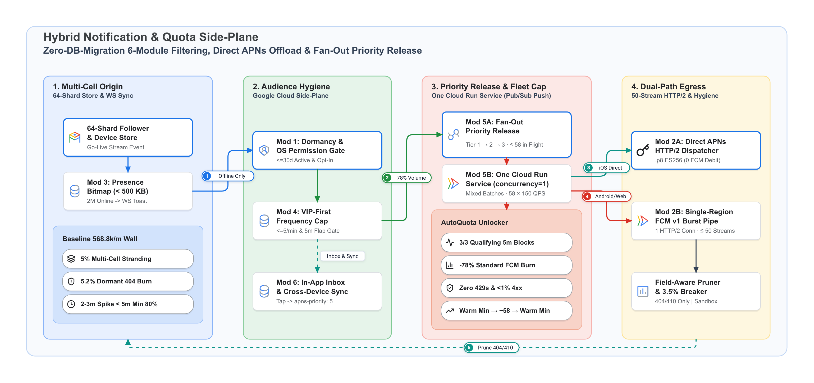

# Push Notifications: Hyperscale Live-Streaming Broadcast Platform

A real-time mobile and web push notification delivery platform and runnable Google Cloud Serverless Side-Plane engineered for hyperscale live-streaming workloads. Designed to handle concurrent broadcast storms with channels of 100,000 to 10,000,000+ followers, completing VIP delivery in under 15 seconds and 100% broadcast delivery across multi-million follower audiences in under 180 seconds, while neutralizing cloud push gateway and mobile operating system bottlenecks.

---

## Architecture Overview

The platform separates notification control-plane intelligence from stateless HTTP/2 transport delivery through a four-layer architecture and a zero-migration Google Cloud Serverless Side-Plane:



### Side-Plane Package Layout

- `cmd/sideplane-demo`: Dual-mode (`--mode=cli` benchmark and `--mode=server` HTTP Control Room) entrypoint.
- `internal/bitmap`: Compact `uint64`-chunked presence bitmap (`250 KB` for 2,000,000 users, lock-free `< 100 ns` lookup) intercepting online viewers via WebSocket toasts.
- `internal/filter`: Decoupled 64-shard `channel_followers` and `user_devices` subscription store, `<= 30d` dormancy and operating system permission gate, 5-minute reconnect flap debounce lock, VIP-first sliding-window `<= 5/min` frequency cap, and downstream-safe payload shaper (`collapse_key` omitted on Android, `ttl: 1800s`, `apns-priority` `10`/`5`).
- `internal/egress`: Domain-blind Layer 3 burst transport featuring stdlib ECDSA P-256 `.p8` ES256 APNs JWT signing, 50-stream HTTP/2 multiplexing (`ForceAttemptHTTP2: true`), field-aware `404 UNREGISTERED` / `410` / `message.token` token pruning, a `3.5%` rolling 4xx load-shedding circuit breaker, and a server-pinned sandbox FCM backbone probe (`<= 6 req/min`).
- `internal/shaper`: 3-Tier priority preemption and prime-time multi-streamer plateau pacer (`520k/min` sustained for `5.92m` across 3 daily waves of 7 staggered 2.0M creators arriving every 40s, unlocking 3/3 daily AutoQuota 5-minute sustained blocks).
- `internal/inbox`: Per-user 30-minute TTL notification inbox and cross-device silent tap-to-dismiss synchronization (`apns-priority: 5` background APNs, FCM data-sync, WebSocket toast sync) with zero origin wakeup RPCs.
- `internal/ui`: Embedded Google Cloud-styled interactive Control Room dashboard.

### Visual Topologies

Architecture and sequence diagrams are authored using Dendrite DSL in `docs/diagrams/` and exported to static high-resolution assets in `docs/assets/`:

- **Hybrid Serverless Side-Plane Architecture**: `docs/assets/hybrid_sideplane.png`
- **Quota and Flow Architecture**: `docs/assets/quota_layers_flow.png`
- **End-to-End Notification Sequence**: `docs/assets/notification_sequence.png`
- **Pilot Spike and Validation Topology**: `docs/assets/pilot_spike_topology.png`

---

## Delivery SLA Targets

During peak traffic scenarios where multiple marquee streamers go live simultaneously:

| Audience Tier | Description | Target Delivery Latency |
| :--- | :--- | :--- |
| **Tier 1 (VIPs)** | Channel moderators, VIP subscribers, active gifters | `< 15 seconds` (`7.6s` in side-plane waves) |
| **Tier 2 (Active 7d)** | Users active on the platform within the past 7 days | `< 45 seconds` (`25.4s` in side-plane waves) |
| **Tier 3 (Casual 8–30d)** | Casual followers active within the past 30 days | `< 180 seconds` (`< 160s` worst-case in side-plane waves) |

---

## Operating Principles & Safety Mitigations

### 1. Eliminating Gateway Edge Bottlenecks
Standard push gateway topics impose subscription ceilings and limited concurrent fan-out channels. The platform replaces topics with a decoupled, horizontally partitioned fan-out store, enabling predictable query pacing across 64 parallel database shards.

### 2. Eliminating Downstream Mobile Operating System Traps
- **Omission of Collapse Keys**: Android devices enforce a limit of 4 unique collapse keys with non-deterministic eviction. Stream notifications omit collapse keys to ensure reliable lock-screen presentation.
- **Server-Side Debouncing**: A 5-minute debounce window prevents rapid broadcast reconnects from exhausting mobile device collapsible token buckets.
- **Bounded Time-To-Live**: Time-to-live is capped at 1,800 seconds (30 minutes) to eliminate stale alert pile-ups and buffer purges on offline devices.
- **Pre-Filtering Revoked Permissions**: Device tokens with revoked operating system notification permissions are filtered before dispatch to protect application standby priority status.

### 3. Field-Aware Error Classification
Cloud gateway errors are evaluated with field-level precision:
- `HTTP 404 UNREGISTERED`, APNs `HTTP 410`, or `HTTP 400` errors targeting `message.token` trigger immediate token deactivation.
- `HTTP 400` schema or payload formatting errors never trigger token pruning, safeguarding active device registries against accidental purge during application upgrades.

---

## CLI Flags, Environment Variables & REST API

### Binary Flags (`cmd/sideplane-demo`)

- `--mode`: Execution mode (`cli` for deterministic benchmark output, `server` for HTTP Control Room and APIs; default `cli`).
- `--port`: HTTP listen port when `--mode=server` (overrides `PORT`; default `8080`).
- `--followers`: Simulated follower count per creator (default `2000000`).

### Environment Variables

- `PORT`: HTTP server listen port (default `8080`).
- `PROJECT_ID`: Target Google Cloud project for `./scripts/deploy-cloudrun.sh` (allowlisted to `kunal-scratch`).
- `SANDBOX_FCM_PROJECT_ID`: Server-pinned Firebase project ID for `POST /api/probe-fcm` (strictly allowlisted to `kunal-scratch`; any client-supplied project identifier is ignored).
- `REGION`: Target Google Cloud Run region for `./scripts/deploy-cloudrun.sh` (default `us-central1`).
- `SERVICE_NAME`: Target Cloud Run service name for `./scripts/deploy-cloudrun.sh` (default `push-sideplane-demo`).

### HTTP Endpoints (`--mode=server`)

- `GET /`: Interactive Google Cloud Control Room UI.
- `GET /api/health`, `GET /healthz`: Health check endpoints returning `200 OK` (use `/api/health` behind Cloud Run `*.run.app`).
- `GET /api/simulate`: Returns full JSON simulation telemetry for both single-creator bursts and prime-time multi-streamer waves (optional `?followers=2000000`).
- `GET /api/inbox`: Returns the seeded multi-device notification inbox state.
- `POST /api/inbox/tap`: Marks a notification `READ` and emits silent cross-device dismissal envelopes (`apns-priority: 5`, zero origin wakeup RPCs).
- `POST /api/inbox/reset`: Resets the demo inbox to unread state.
- `POST /api/probe-fcm`: Executes a server-pinned `validate_only` HTTP/2 probe against `fcm.googleapis.com` (rate-limited to `<= 6 req/min`).

---

## Development & Makefile Targets

Standard operational and verification tasks are orchestrated via the root `Makefile`:

- `make build` — Compile the `bin/sideplane-demo` binary.
- `make test` — Run repository tidiness checks, diagram/hygiene scans, and the Go `-race` test suite with bounded timeouts.
- `make run` — Execute the deterministic CLI side-plane benchmark (`--mode=cli`).
- `make clean` — Remove temporary build artifacts and Go test caches.
- `make tidy-check` — Verify repository tidiness, script permissions, and documentation synchronization.
- `make help` — Display available command targets.

### Running Locally

```bash
# Run CLI benchmark
make run

# Start interactive Control Room server locally
SANDBOX_FCM_PROJECT_ID=kunal-scratch PORT=8080 go run ./cmd/sideplane-demo --mode=server
```

---

## Cloud Run Sandbox Deployment

Deploy the containerized Control Room and live HTTP/2 FCM probe service to Google Cloud Run (`kunal-scratch`, `us-central1`):

```bash
PROJECT_ID=kunal-scratch SANDBOX_FCM_PROJECT_ID=kunal-scratch ./scripts/deploy-cloudrun.sh
```

The deployment script enforces the sandbox allowlist (`kunal-scratch`, rejecting any `prod` or `live` project names), builds from `Dockerfile`, attempts `--allow-unauthenticated` first, and if organization IAM policy restricts `allUsers`, automatically falls back to `--no-allow-unauthenticated` and verifies `/api/health` and `/api/simulate` using an IAM identity token (`gcloud auth print-identity-token`). For local browser access behind IAM authentication, run:

```bash
gcloud run services proxy push-sideplane-demo --project=kunal-scratch --region=us-central1 --port=8080
```

---

## References

- [System Scope and Architectural Strategy](docs/notification_platform_scope.md)
- [Pilot Spike Plan and Validation Methodology](docs/pilot_spike_plan.md)

---

## License

This project is licensed under the [Apache License, Version 2.0](LICENSE).
