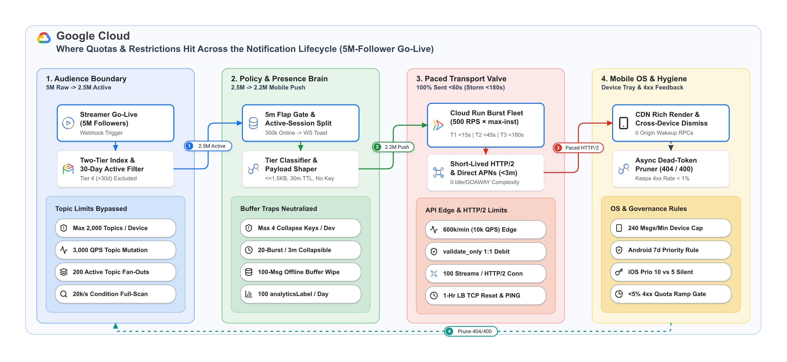
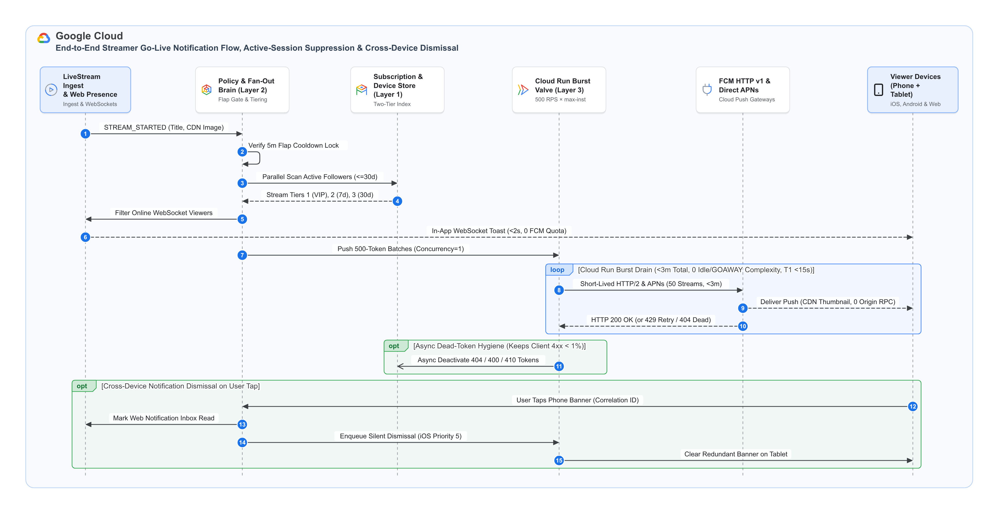

# Notification Delivery Platform — System Scope

**19 Oct 2026**  
**Target Workload:** Hyperscale Real-Time Live-Streaming Fan-Out

---

## 1. The Challenge & Target Delivery SLAs

### 1.1 Why "Streamer Go-Live" Fan-Out Breaks Standard Push Pipelines

Live-streaming platforms operate globally where marquee creators have **100,000 to 10,000,000+ followers**. Unlike 1:1 conversational or transactional notifications (such as direct mentions or chat replies, which arrive naturally staggered across the hour), a "Streamer Go-Live" event—or 10 to 20 creators going live simultaneously at the top of prime-time hours—triggers an instantaneous **1:N step-function spike of 5,000,000 to 30,000,000+ notifications at $t = 0$**.

Because live-stream alerts have an ultra-short relevance half-life, pushing 30M unfiltered followers through a single Firebase Cloud Messaging (FCM) project's default **600,000 messages/minute (10,000 QPS)** pipe creates a **50-minute queue backlog**—delivering notifications long after the broadcast intro, chat momentum, and initial raid wave have passed:

```math
T_{\text{legacy\_drain}} = \frac{30{,}000{,}000\text{ unfiltered notifications}}{600{,}000\text{ messages/minute}} = \mathbf{50.0\text{ minutes}\ (50\text{–}90\text{ mins with HTTP 429 retry storms})}
```

### 1.2 The 4 Volume & Speed Multipliers: Compressing 50 Minutes into `< 2–3 Minutes`

Hyperscale streaming platforms (such as Twitch and Discord) never dump raw historical follower lists into FCM Topics or unpaced HTTP loops. Instead, this architecture pairs a **Smart Notification Control Plane** with a **Stateless Cloud Run Burst Pipe**, applying four compounding multipliers to shrink a **30,000,000-follower prime-time storm** into **6,600,000 Android FCM pushes + 6,600,000 Direct APNs pushes** and complete **100% of delivery in `< 2–3 minutes`**:

1. **30-Day Dormancy & OS Permission Filter (`-50%` Volume)**:
   Excludes uninstalled tokens, OS-permission-revoked devices (`os_permission_granted = false`), and accounts inactive for `> 30 days` at the database read boundary (`30M` → **`15.0M` active followers**).
2. **Active-Session WebSocket Intercept (`-12%` Volume at `0` Push Quota)**:
   Diverts viewers who are *already watching the broadcast on Web or Mobile* (`1.8M` users) to an instant **`< 2s` in-app WebSocket toast**, saving push quota and preventing pocket-buzz spam (`15.0M` → **`13.2M` offline mobile pushes**).
3. **Direct APNs Offload for iOS (`-50%` FCM Quota Load)**:
   Routes iOS tokens (**`6.6M`**) directly to `api.push.apple.com` over HTTP/2 and sends only Android/Web tokens (**`6.6M`**) to `fcm.googleapis.com`—doubling effective send capacity and eliminating FCM-to-APNs proxy jitter.
4. **Priority-Tiered Cloud Run Burst Lanes**:
   Drains the remaining mobile pushes across three priority queues so paid subscribers and daily viewers never wait behind casual followers:

| Audience Segment / Capability | Target SLA | Scope & Architectural Mechanism |
| :--- | :--- | :--- |
| **Online Viewers (Active on Web/App)** | **`< 2 seconds`** | Roaring Bitmap presence check routes online users to an in-app WebSocket toast (`0` FCM/APNs quota used). |
| **Tier 1: Paid Subscribers & Channel VIPs** | **`p99 < 15 seconds`** | Dedicated high-priority queue + warm Cloud Run pool (`min-instances: 2`) for zero cold-start latency. |
| **Tier 2: Active 7-Day Viewers** | **`p99 < 45 seconds`** | Priority 2 queue drained across parallel HTTP/2 FCM (Android) and Direct APNs (iOS) workers. |
| **Tier 3: Casual 8–30d Viewers (100% Completion)** | **`p99 < 180 seconds`** | Smoothly paced across the 3-minute window (`< 30–60s` for a single 5M stream; `< 120–180s` for a 30M storm). |
| **Tier 4: Dormant Viewers (`> 30d` / No OS Perm)** | **`0%` Go-Live Share** | Filtered out during shard scan to protect quota, `< 1%` 4xx hygiene, and Android 7-day high-priority standing. |
| **Cross-Device Banner Dismissal & Origin Protection** | **`< 3s` Sync / `0` RPCs** | Self-sufficient `<= 1.5 KB` CDN payload requires `0` origin calls on wakeup; tapping on Device A clears Device B. |

> [!NOTE]
> **Zero Pre-Existing Tiers Required on Day 1:** The platform does not need pre-classified `Tier 1..4` database columns to launch. It supports a **Progressive Rollout**: launch on Day 1 using existing `last_active_at` timestamps, and enable VIP/recency tiers incrementally via billing webhooks and write-coalesced (12-hour) client activity heartbeats.

---

## 2. Four Core Architectural Questions (And the "Gotchas" Under the Hood)

### 2.1 Mass Fan-Out Architecture ("Smart Control Plane, Simple Cloud Run Pipe")

Modern FCM HTTP v1 (`messages:send`) is strictly **1-to-1 per device token**. To fan out millions of notifications without event-loop starvation, socket exhaustion, or `HTTP 429` storms, the platform separates business intelligence from wire-level transport across four layers:



* **Layer 1 — Two-Tier Subscription & Device Store (Push-Ignorant)**:
  Decouples channel follows (`channel_followers`, hash-partitioned into **64 parallel scan buckets**) from device state (`user_devices`). When a user rotates a token or opens the app, updating `last_active_at` mutates **1 row** instead of 2,000 follower rows (eliminating database write amplification).
* **Layer 2 — Policy, Flap Gate & Presence Brain (Smart Control Plane)**:
  Owns all business and OS compliance rules—absorbing OBS encoder flaps via a **5-minute Redis cooldown**, diverting online viewers to WebSocket toasts, capping per-user overlap during multi-streamer storms at **`<= 5 pushes/min`** (`VIP-first`), and emitting compliant **500-token batches** to priority Pub/Sub queues (`Tier 1`, `Tier 2`, `Tier 3`).
* **Layer 3 — Stateless Cloud Run Burst Pipe (Domain-Blind Transport)**:
  Ephemeral serverless workers (`concurrency = 1` batch of 500 tokens per instance) that dispatch 500 tokens over **1 standard HTTP/2 TCP connection** using a **50-goroutine semaphore** (`<= 50` concurrent streams/socket). Total fleet QPS is governed declaratively via Cloud Run `max-instances` with **zero Redis rate-limiter coordination**.
* **Layer 4 — Mobile OS Edge & Async Hygiene Loop**:
  Renders rich alerts directly from CDN URLs (`0` origin RPCs), syncs cross-device dismissals, and routes permanent token errors (`404`, `410`, invalid-token `400`) to an async dead-token pruner protected by a **`3.5%` rolling 4xx circuit breaker** (which automatically sheds Tier 3 casual traffic during dead-token surges to protect Tier 1/2 delivery).

---

### 2.2 FCM Topics vs. Direct Tokens (And Why 2,000+ Topics Breaks)

Native FCM Topics (`/topics/streamer_{id}`) are built for coarse regional broadcasts (such as weather alerts) and break live-streaming platforms across three hard limits:

1. **Hard 2,000-Topic Ceiling per Device**:
   Firebase's Instance Registry caps subscriptions at **2,000 topics per app instance**. When an active power user follows channel #2,001, FCM rejects the request with **`HTTP 400 TOO_MANY_TOPIC_SUBSCRIPTIONS`**.
2. **Subscription Mutation Rate Limits**:
   Topic subscribe/unsubscribe calls are throttled to **3,000 QPS per project (`180k/min`)** and **100 mutations/minute per device token**—triggering cascading `HTTP 429` errors during raids or app-launch syncs.
3. **200-Concurrent Topic Fan-Out Dilution**:
   While FCM accepts up to 1,000 queued topic publish calls (`HTTP 200 OK`), its internal fan-out scheduler actively executes at most **200 concurrent topic fan-outs (~240 worker slices at ~83 QPS each)** across the entire project. When 20+ creators go live at `:00`, topic throughput is diluted across streams and silently backlogs for **20 to 60+ minutes**. *(Topic Conditions like `'a' in topics && 'b' in topics` are even slower, scanning every device in the project at 20,000 devices/sec).*

**The Solution & Zero-QPS Topic Cutover**: Replace FCM Topics with a 64-shard Two-Tier Inverted Index (`channel_followers` + `user_devices`). To decommission existing topics **without triggering a 3,000 QPS / 100 QPM unsubscribe storm**:
* **Step 1 (Immediate Server Cutover — 0 QPS)**: Stop publishing to `/topics/streamer_*` on the backend and switch 100% of Go-Live sends to the Two-Tier Index. Dormant topic bindings in Firebase cost `$0` and consume `0` send quota once publishing stops.
* **Step 2 (Client Stop-Write)**: Ship a mobile app update removing all `subscribeToTopic()` and `unsubscribeFromTopic()` calls. **Never** run a client loop on startup to unsubscribe users from legacy streamer topics.

---

### 2.3 Rate Limiting, Batching & The 4 Downstream Mobile OS Traps

#### Server & Transport Mechanics

* **The "500-Batch" Multicast Fallacy & Rolling 60s Window**:
  Admin SDK helpers (`sendEach()`, `sendEachForMulticast()`) do **not** send a single bulk HTTP request; they unpack the array and fire **500 individual HTTP/2 `POST` streams**. Each message debits 1 unit from FCM's **600,000 msgs/min (10,000 QPS)** rolling 60-second token bucket (which is evaluated continuously, not reset on `:00` clock minutes).
* **4xx Errors Burn Quota 1:1 (Field-Aware Pruning Required)**:
  Client `HTTP 400`, `403`, and `404` responses debit send quota 1-for-1 at Google's API edge, and Firebase's automated quota elevation gatekeeper (which approves `<= 25%` self-serve increases up to **6,000,000 msgs/min** when utilization hits `>= 80%` for 15m/day on 4 of 8 days) **auto-rejects requests if client 4xx errors reach `>= 5%`**. Crucially, Layer 4 must inspect `fieldViolations[].field` on `HTTP 400` responses: prune tokens **only** when `field == "message.token"` (or on `404 UNREGISTERED` / APNs `410`), and **never** prune tokens on schema/payload `400` bugs (e.g., `analytics_label`, which must also be capped at `<= 100` unique labels/day via `tier + platform + date`).
* **Why Ephemeral Cloud Run Workers Eliminate HTTP/2 & `GOAWAY` Complexity**:
  Google's Edge HTTP/2 load balancers (`fcm.googleapis.com:443`) enforce `SETTINGS_MAX_CONCURRENT_STREAMS = 100` per TCP socket, force a hard **60-minute `GOAWAY` (`max_age = 3,600,000 ms`)** connection teardown, and drop connections that send keep-alive `PING` frames more than once every 5 minutes when idle (`ENHANCE_YOUR_CALM`). Because a Go-Live burst drains in **`< 2–3 minutes`**, short-lived Cloud Run instances (running 50 streams over 1 TCP socket and caching OAuth tokens from the local metadata server) spin up, drain the queue, and scale down long before 60 minutes—requiring **zero custom socket rotation timers or idle ping policers**.

#### The 4 Downstream Mobile OS Traps (Silent Drops *After* FCM Returns `HTTP 200 OK`)

Even when `fcm.googleapis.com` returns `200 OK`, Android Google Play Services (GMS Core) and Apple APNs enforce four device-side limits that silently drop notifications unless neutralized by Layer 1 and Layer 2:

| Downstream Mobile OS Trap | Device / OS Enforcement Rule | Platform Scope Workaround (Layer 1 & Layer 2) |
| :--- | :--- | :--- |
| **1. 4-Unique-Collapse-Key Offline Eviction** | Offline Android devices store at most **4 unique `collapse_key` values** per token; a 5th streamer key causes **arbitrary, non-FIFO eviction** of older alerts. | **Omit `collapse_key` on Android** (use `apns-collapse-id` on iOS only) and absorb OBS encoder reconnects server-side via a **5-minute Redis stream-flap cooldown**. |
| **2. 20-Burst / 3-Min Collapsible Throttle** | Collapsible messages (`ttl > 0`) are throttled to a **20-message burst** per app/device, refilling at **1 msg per 3 minutes** (plus a 240/min device cap). | Send **non-collapsible Android alerts** paired with a **VIP-first `<= 5/min` (`<= 20/hr`) per-user frequency cap** in Layer 2 during multi-streamer storms. |
| **3. 100-Message Offline Buffer Wipe** | Offline devices buffer max **100 non-collapsible messages** (28d default TTL); the **101st message purges all 100 stored alerts** (`onDeletedMessages()`). | Enforce a strict **30-minute TTL (`ttl: "1800s"`)** + `<= 20/hr` cap so stale stream alerts expire automatically and offline buffers never exceed ~5–10 messages. |
| **4. Android 7-Day Priority Demotion & iOS `apns-priority` Black Hole** | Android demotes apps to `normal` priority for **7 rolling days** if high-priority pushes fail to show a visible banner; on iOS, FCM returns a **false-positive `200 OK`** on invalid `background` + `apns-priority: 10` pushes before Apple drops them (`400 BadPriorityForPushType`). | Filter `os_permission_granted = true` at Layer 1, embed a self-sufficient **`<= 1.5 KB` CDN payload** (`0` blocking wakeup RPCs), enforce **`apns-priority: 5` on silent syncs vs. `10` on visible alerts** in Layer 2, and use **Direct APNs** for iOS. |

---

### 2.4 Dry Runs & Million-Recipient Load Testing

* **The `"validate_only": true` Quota Trap**:
  Google Cloud's API Edge debits production `fcm.googleapis.com/send_requests` quota upon RPC arrival *before* inspecting `"validate_only": true` in the payload. Running a multi-million dry-run load test against the production Firebase project will immediately exhaust the 600k/min quota and trigger live `HTTP 429` outages.
* **The 3-Tier Zero-Production-Quota Testing Strategy**:
  1. **Tier 1 — Internal HTTP/2 Mock Server (1M–50M+ Scale, `0` Quota Cost)**:
     Emulates Google's HTTP/2 edge (`MaxConcurrentStreams: 100`, token-bucket quota pacing, configurable `429`/`404` fault injection) to benchmark 64-shard DB scans, Pub/Sub chunking, and worker scaling at 50k–100k+ QPS with zero external traffic.
  2. **Tier 2 — Dedicated Sandbox Firebase Project (`validate_only: true` Quota Path)**:
     Sends `validate_only: true` requests using a small pool of real test device tokens in an **isolated non-production Firebase project** to validate live OAuth credentials, HTTP/2 ALPN (`h2`) multiplexing, error classifiers, and the real 600k/min edge quota path without hitting Android's 240 msgs/min per-device delivery cap.
  3. **Tier 3 — Physical Hardware Canary (20–50 Devices)**:
     Delivers real end-to-end pushes to an internal test device farm to verify Android Doze wakeup, CDN thumbnail rendering, and cross-device banner dismissal.

---

## 3. End-to-End Flow & Build-vs-Adopt Options (Cloud Run, Gorush, Novu)

### 3.1 End-to-End Notification Lifecycle Sequence

The sequence diagram below traces how a "Streamer Go-Live" event flows across all four layers—from 5-minute stream-flap deduplication and 64-shard audience extraction to WebSocket presence suppression, tiered Cloud Run HTTP/2 dispatch, async dead-token pruning, and cross-device banner dismissal:



### 3.2 Pragmatic Build-vs-Adopt Options (Avoiding Reinventing the Wheel)

Because the architecture cleanly separates the **Layer 2 Control Plane** from the **Layer 3 Burst Pipe**, teams can combine lean custom Go with battle-tested open-source components:

* **Layer 3 Burst Transport — Why Serverless Cloud Run Beats GKE Autopilot for Go-Live Spikes**:
  * **The GKE Autopilot Cold-Node Trap**: When a sudden multi-million Go-Live spike hits, GKE Autopilot takes **45–90 seconds** to provision new underlying VM nodes before KEDA pods can schedule—violating the `< 15s` VIP SLA unless running 24/7 idle standby "balloon pods".
  * **Serverless Cloud Run Burst Scaling (`2–5s` Spin-Up, `$0` Idle Cost)**: Cloud Run scales `0 -> 200` instances in **2–5 seconds** from Google's pre-warmed pool (`min-instances: 2` on Tier 1 for instant VIP dispatch; `min-instances: 0` on Tiers 2 & 3). There are two clean Layer 3 engine options on Cloud Run:
    1. **Option 1 (Recommended) — ~60-Line Native Go Cloud Run Worker**: A single ~15 MB static Go container (`concurrency = 1` batch of 500 tokens, 50-goroutine semaphore over 1 standard `http.Client` socket to FCM/APNs). Zero sidecar IPC hop, lowest memory footprint, and fastest tail latency.
    2. **Option 2 (Turnkey OSS) — Unmodified [`Gorush`](https://github.com/appleboy/gorush) + ~30-Line Sidecar on Cloud Run**: `appleboy/gorush` is a stateless ~25 MB Go binary (`queue.engine: "local"`, `stat.engine: "memory"`) that runs on Cloud Run when configured with **`"sync": true` and `core.workers: 50`**—forcing each 500-token batch to block synchronously (~1s) and return failed/unregistered tokens before the HTTP response finishes (preventing Cloud Run from throttling CPU mid-flight).
* **Layer 2 Control Plane — Custom Go Fan-Out Coordinator + Optional [`Novu`](https://github.com/novuhq/novu) on GKE**:
  * Self-hosted **Novu on GKE** provides turnkey APIs and UI components for **User Notification Preferences, Template/Localization Management, the In-App WebSocket Inbox, and 1:1 Transactional Notifications** (chat mentions, sub renewals, gift subs, payouts).
  * Because Novu's BullMQ/Redis workflow engine materializes per-subscriber jobs (which bottlenecks on multi-million 1:N spikes), **1:N "Streamer Go-Live" broadcasts bypass Novu's workflow queue** and route directly through the **Go Fan-Out Coordinator → Priority Pub/Sub Queues → Cloud Run Burst Fleet**.

| Dimension | Option 1 (Recommended): ~60-LoC Native Go on Cloud Run + Go Coordinator *(+ Optional `Novu`)* | Option 2 (Turnkey OSS): `Gorush` (`sync: true`) on Cloud Run + Go Coordinator *(+ Optional `Novu`)* | Option 3: All-GKE Autopilot (`Gorush` or Custom Go with KEDA + Balloon Pods) | Option 4: Commercial Push SaaS *(Braze, OneSignal, Customer.io)* |
| :--- | :--- | :--- | :--- | :--- |
| **Layer 3 Complexity** | **Lowest (~60 LoC standard Go)**; single container, 1 socket, 50 streams, 0 sidecar hop. | **Ultra-Low (~30 LoC sidecar + stock `Gorush`)**; dual-container localhost hop. | **Moderate-to-High**; requires KEDA tuning, standby balloon pods, and Redis rate limiters. | **Low initial code**, but requires syncing 50M+ follow graphs to external vendor. |
| **Spike Scaling (`0 -> 100k RPS`)** | **`1–3 seconds`** (Serverless Cloud Run pre-warmed pool). | **`2–5 seconds`** (Serverless Cloud Run pre-warmed pool). | **`45–90 seconds`** (Blocked by GKE Autopilot VM provisioning unless over-provisioned 24/7). | **Opaque** (Shared multi-tenant vendor queues). |
| **Quota Pacing & `GOAWAY` Safety** | **Declarative via `max-instances`**; `< 3m` ephemeral lifetime eliminates 60m `GOAWAY` by design. | **Declarative via `max-instances`**; `< 3m` ephemeral lifetime eliminates 60m `GOAWAY` by design. | **App/Redis Token Bucket** + explicit socket `MaxConnectionAge` / pod scale-down timers. | **Opaque** (Still bound by the underlying Firebase project quota). |
| **50M+ Device Cost Profile** | **Lowest** (Pay-per-burst serverless compute; `$0` idle cost on Tiers 2 & 3). | **Lowest** (Pay-per-burst serverless compute; `$0` idle cost on Tiers 2 & 3). | **Moderate** (24/7 standby balloon node cost to avoid 45–90s cold starts). | **Very High** (`$500k–$2M+/yr` in MAU and message overages). |

---

## 4. Open Decisions to Lock In Before Detailed Design

Before proceeding to the **Detailed System Design (`/design`)** phase—where exact SQL/NoSQL schemas, Go interfaces, Pub/Sub topologies, and Terraform/Cloud Run configurations will be specified—the following five decisions are queued for alignment. All recommended options below have been empirically validated in our companion benchmark spike (see [References](#references)):

| # | Decision Area | Recommended Option | Alternative Option(s) | Key Trade-Off to Align On |
| :--- | :--- | :--- | :--- | :--- |
| **1** | **Inverted Index Storage Engine** | **AlloyDB for PostgreSQL** (Zero-lag Read Pools + 64 hash partitions for `<= 100M` devices) | **Cloud Bigtable** (Two-table prefix scan) or **Hybrid AlloyDB + Bigtable/Redis CDC** | Standard PostgreSQL operational simplicity (3–8s parallel scan) vs. sub-2s NoSQL prefix scans at higher operational complexity. |
| **2** | **iOS Push Egress Topology** | **Hybrid Egress** (Direct APNs HTTP/2 `.p8` for iOS + FCM HTTP v1 for Android/Web) | **Unified FCM HTTP v1 Egress** (Both Android and iOS routed through FCM) | Direct APNs frees **50% of FCM project quota**, removes +30–200ms proxy jitter, and exposes APNs `400`/`410` errors vs. maintaining a single protocol. |
| **3** | **FCM Quota Scaling (600k/m → 5M+)** | **Single Prod Firebase Project + Stepped Quota Ramp (to 6M/min)** + Direct APNs Offload | **$K$-Project Sharding** ($K = 5$ Firebase projects for immediate 3M/min baseline) | Single-project mobile client simplicity (with 8-day utilization ramp) vs. day-1 multi-project capacity (requiring dynamic client Firebase config). |
| **4** | **Layer 3 Runtime & Layer 2 Inbox Stack** | **~60-Line Native Go on Cloud Run** (Layer 3) + **Go Coordinator & Optional `Novu` on GKE** (Layer 2) | **`Gorush` (`sync: true`) Sidecar on Cloud Run** or **All-GKE Autopilot with Balloon Pods** | Single-container Go performance & 1–3s serverless scaling vs. turnkey `Gorush` binary or single-cluster GKE Autopilot footprint. |
| **5** | **Rollout Phasing & Topic Cutover** | **Day-1 Active-Session WS Suppression + Phase-2 Cross-Device Dismissal** & **Inert Topic Cutover** | **Full Day-1 Co-Launch** + **Off-Peak Server `batchRemove` Topic Sweep (`<= 500 QPS`)** | Immediate 12%+ quota savings on Day 1 without blocking on mobile client dismissal handlers; zero-QPS topic cutover vs. reclaiming topic slots. |

---

## References

* **Empirical Pilot Spike & Benchmark Validation**: [55M-Follower 10-Streamer Storm & Live FCM v1 Validation (GitHub Discussion #2)](https://github.com/kunal-labs/push-notifications/discussions/2) — Full wire-level HTTP/2 multiplexing telemetry, Native Go vs. `Gorush` head-to-head benchmarks, and 15M-device downstream OS trap validation supporting the recommendations in this scope.
